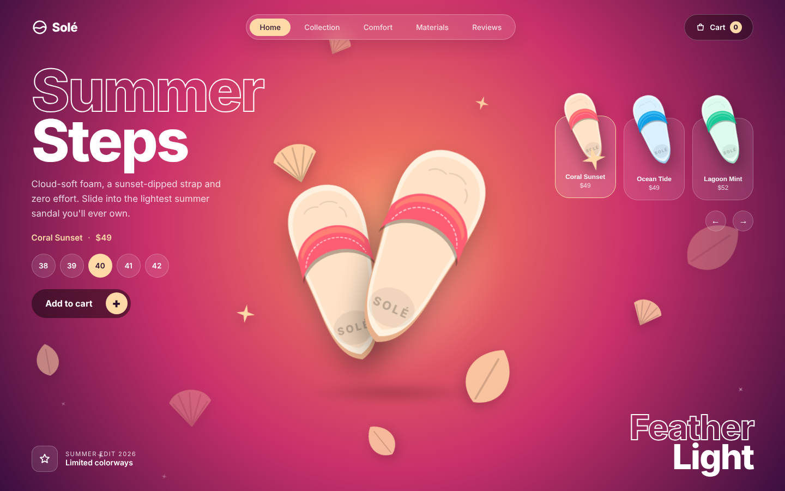
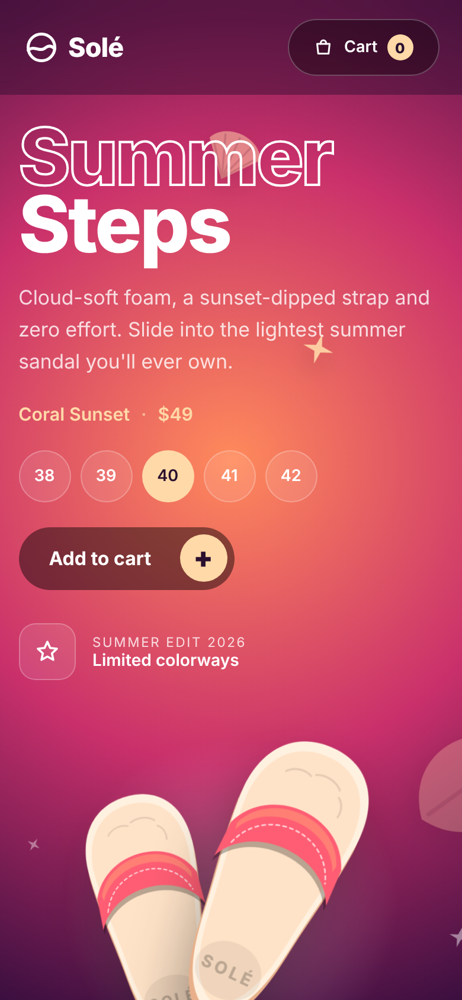

<h1 align="center">👟 Solé Slides</h1>

<p align="center"><i>Frontend UI demo: a sunset-themed product landing page for a fictional sandal brand</i></p>

<p align="center">
  
  
  
  
</p>

<p align="center">
  
</p>

> **Solé is a fictional brand.** This project is a UI/UX demo only. There is no real store, checkout, or backend.

## Features

- **Three colorways** (Coral Sunset, Ocean Tide, Lagoon Mint). Switching spins the product and smoothly transitions the whole page palette: background, sandal, buttons, and accents.
- **Original SVG sandal artwork** drawn with CSS variables, so one drawing powers the hero, the colorway cards, and every theme.
- **Pointer parallax**: the product tilts in 3D and the decorative layers (leaves, shells, sparkles) move at different depths.
- **Ambient motion**: floating decorations, rising sparkles, and a breathing ground shadow.
- **Working UI state**: size picker, add-to-cart with animated counter, and an accessible toast message.
- **Keyboard support**: `←` / `→` to switch colorways.
- **Responsive**: 3-column desktop, 2-column tablet, stacked mobile.
- **Accessible**: semantic markup, `aria-pressed` states, live regions, visible focus rings, and `prefers-reduced-motion` support.
- **Zero dependencies**: plain HTML, CSS, and JavaScript. No build step.

<p align="center">
  
</p>

## Run locally

No installation needed. Open `index.html` in a browser, or serve the folder:

```bash
# Python
python -m http.server 8000

# or Node
npx serve .
```

Then open <http://localhost:8000>.

## Deploy (free)

The site is fully static, so it works on GitHub Pages:

1. Push the repo to GitHub.
2. Go to **Settings → Pages**.
3. Under *Build and deployment*, choose **Deploy from a branch**, then `main` and `/ (root)`.
4. Your site goes live at `https://<username>.github.io/<repo-name>/`.

## Project structure

```
sole-slides/
├── index.html      # markup + SVG symbols (sandal, leaf, shell, sparkle)
├── style.css       # theme tokens, layout, animations, responsive rules
├── script.js       # colorway switching, parallax, cart, decorations
├── assets/         # screenshots
└── LICENSE
```

## How it works

- Each colorway is a set of CSS custom properties on `[data-variant="..."]`. The variables are registered with `@property`, so changing `body[data-variant]` animates every color smoothly.
- The sandal is a single SVG `<symbol>` that reads those variables. Colorway cards reuse it with their own `data-variant`, so each card previews its own colors.
- Decorative elements use the individual `translate`, `rotate`, and `scale` CSS properties, so the idle float (CSS), the switch animation (Web Animations API), and the parallax (JavaScript) never fight over `transform`.

## Customize

Add a colorway in three steps:

1. Add a `[data-variant="yourname"]` block in `style.css` with the nine color variables.
2. Add a `.card` button in `index.html` with `data-variant`, `data-name`, and `data-price`.
3. That's it. The script picks up cards automatically.

## Browser support

Modern evergreen browsers. Smooth color transitions use `@property` (Chrome/Edge 85+, Safari 16.4+, Firefox 128+). In older browsers the colors still change, just without the fade.

## Credits

The layout idea (hero title, side title, floating objects, product carousel with a theme change) was inspired by a "Diet Soda" landing page by **Abdughafur Khujzoda**. This implementation was written from scratch: the markup, styles, scripts, and all artwork are new, and no assets from the original are used.

